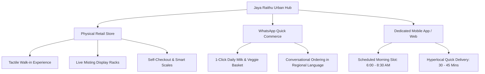
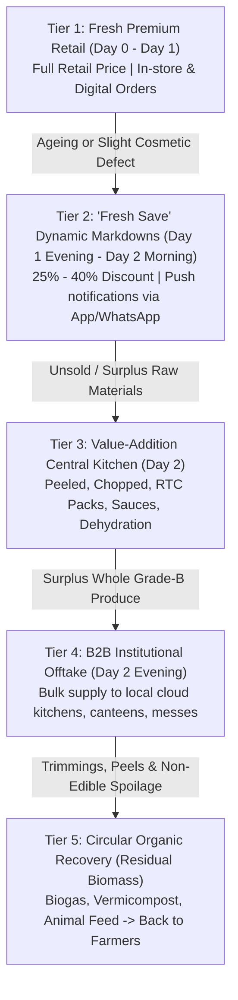
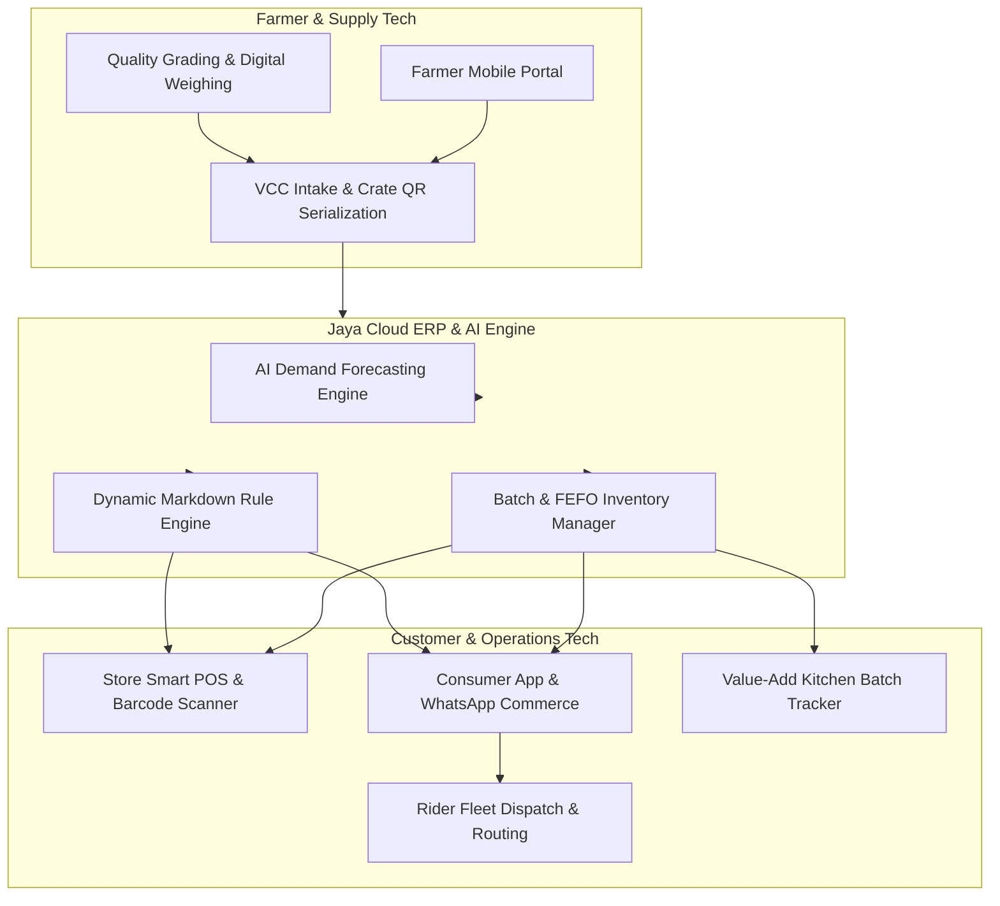
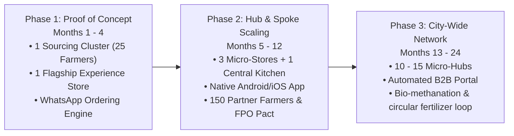

# Jaya Raithu Market — Complete Business & Operational Blueprint

**A Farm-to-Fork Direct Sourcing & Zero-Waste Omnichannel Agritech Retail Model**

---

## 1. Executive Summary & Strategic Foundation

### 1.1 Vision & Mission
* **Vision:** To build the most trustworthy, equitable, and zero-waste fresh food supply network connecting peri-urban farming clusters directly with urban communities.
* **Mission:** 
  1. Increase farmer income realization by **25%–40%** through transparent grading, zero commissions, and prompt settlement.
  2. Deliver farm-fresh produce to households within **12–18 hours of harvest** at fair, consistent retail prices.
  3. Limit fresh produce supply-chain post-harvest wastage to **under 3%** (industry benchmark: 20%–35%) via a disciplined 5-Tier Zero-Waste Cascade.

### 1.2 Core Problem & Market Gap
| Traditional Supply Chain (APMC Mandi Model) | Jaya Raithu Market Model |
| :--- | :--- |
| **5–7 Intermediaries:** Farmer → Village aggregator → Commission agent → Big mandi wholesaler → Sub-wholesaler → Retailer → Customer | **Direct 2-Step Sourcing:** Farmer / FPO → Jaya Village Collection Center (CC) → Urban Retail Hub / Dark Store → Customer |
| **Farmer realization:** Only 25%–35% of the consumer rupee. High deductions for unloading, weighing, and commissions. | **Farmer realization:** 60%–70% of consumer rupee, transparent electronic weighing, no middlemen cuts. |
| **Transit lag:** 36–72 hours from harvest to kitchen; high moisture loss, chemical ripening, nutrient degradation. | **Transit lag:** 8–16 hours farm-to-shelf, maintaining peak hydration and nutrition. |
| **Wastage:** 25%–40% of produce degrades and ends up in municipal landfills. | **Wastage:** < 3% landfill waste via dynamic markdown, RTC processing, B2B, and circular composting. |

```mermaid
flowchart LR
    subgraph Traditional [Traditional Mandi Chain: 36-72 hrs | 25-35% Farmer Share]
        F1[Farmer] --> A1[Local Aggregator]
        A1 --> M1[APMC Agent]
        M1 --> W1[City Wholesaler]
        W1 --> SW1[Sub-Wholesaler]
        SW1 --> R1[Vendor / Kirana]
        R1 --> C1[Consumer]
    end

    subgraph JayaModel [Jaya Raithu Market: 8-16 hrs | 60-70% Farmer Share]
        F2[Farmer / FPO] --> CC[Village Collection Center]
        CC --> HUB[Jaya Urban Storage Hub & Store]
        HUB --> STORE[Walk-in Experience Store]
        HUB --> APP[Digital App / WhatsApp Delivery]
        HUB --> KITCHEN[Value-Add Kitchen]
        STORE --> C2[Consumer]
        APP --> C2
    end
```

---

## 2. Upstream Farmer Ecosystem & Sourcing Operations

### 2.1 Cluster-Based Sourcing Strategy
* **Geographical Proximity:** Source within a **50–120 km radius** of target urban centers (peri-urban green belts) to enable evening harvest and early morning shelf arrival.
* **Partnership Structure:** 
  * Direct onboarding of progressive individual farmers.
  * Formal partnerships with Farmer Producer Organizations (FPOs) and SHGs (Self-Help Groups).
* **Guaranteed Offtake & Crop Calendar Alignment:** Co-plan crop cycles with farmers based on consumer demand trends to prevent oversupply and seasonal glut pricing crashes.

### 2.2 Transparent Pricing & Settlement Protocol
* **Dynamic Benchmarking:** Pricing pegged daily to the local APMC wholesale rate + a **15%–25% direct quality premium**, providing farmers higher net cash than open auction mandis.
* **Fair Weighing:** Industrial digital scales with instant SMS weight receipt sent to the farmer's mobile.
* **T+1 Cash Settlement:** Payments disbursed directly to farmer bank accounts via UPI/NEFT within 24 hours, eliminating traditional 15–45 day credit cycles.

### 2.3 Village Collection Centers (VCCs)
* **Function:** Hyperlocal drop-off points located within 5–8 km of farm clusters.
* **Operations:**
  * **Intake Window:** 3:00 PM – 7:00 PM daily.
  * **Pre-Cooling & Washing:** Basic hydro-cooling/sorting on sanitized food-grade stainless steel tables.
  * **Standardized Crate Packaging:** Reusable, perforated, food-grade HDPE plastic crates (color-coded by category: greens, fruits, root vegetables). No rough gunny sacks that bruise produce.

---

## 3. Storage, Cold-Chain & Hyperlocal Logistics

### 3.1 Post-Harvest Preservation & Transport
* **Night Transit Linehaul:** Crates loaded into insulated/reefer tempo vans departing VCCs by 9:00 PM, arriving at urban central hubs between 11:30 PM and 1:00 AM.
* **Zero Damage Handling:** Crates are stackable with interlocking tabs; zero manual tossing or dumping of loose vegetables.

### 3.2 Multi-Zone Urban Storage Architecture
Each Jaya Raithu Urban Hub features a 3-Zone climate-controlled holding facility:

| Storage Zone | Temperature & Humidity | Products Stored | Preservation Objective |
| :--- | :--- | :--- | :--- |
| **Zone A: Cold & High Humidity** | 2°C – 6°C \| 90%–95% RH | Leafy greens (palak, methi, coriander), broccoli, bell peppers, carrots | Prevents moisture transpiration and wilting. |
| **Zone B: Chilled & Moderate RH** | 10°C – 14°C \| 80%–85% RH | Tropical fruits, tomatoes, gourds, cucumbers | Prevents chilling injury while retarding over-ripening. |
| **Zone C: Ambient & Well-Ventilated** | 20°C – 25°C \| Dry, Dark | Onions, potatoes, garlic, yams, ginger | Dark, well-aerated racks to prevent sprouting and fungal rot. |

> [!IMPORTANT]
> **Ethylene Segregation Protocol:** High ethylene producers (ripening bananas, apples, papayas, tomatoes) must be stored in isolated, ventilated chambers away from ethylene-sensitive items (leafy greens, carrots, cucumbers) to stop premature yellowing and spoiling.

---

## 4. Omnichannel Sales & Customer Experience

Jaya Raithu Market bridges the trust of a local neighborhood market with the speed of digital commerce.



### 4.1 Physical Store Model ("The Raithu Experience Store")
* **Location:** High-density residential catchments (tier-1/tier-2 apartment complexes and community hubs).
* **Footprint:** 800 – 1,500 sq. ft.
* **Key Features:**
  * **Farm Transparency Boards:** Digital screens displaying today's farmer names, village origin, and harvest timestamp.
  * **Hydrated Display:** Ultrasonic fine misting systems on leafy green racks keeping leaves crisp all day.
  * **Hygiene Standard:** Zero wet floors; sanitized steel displays; digital weighing scales printing weight-and-price barcodes.

### 4.2 Digital Commerce Channels
1. **WhatsApp Commerce Bot:**
   * Instant catalog access, regional language voice-note ordering, daily essentials subscription (leafy greens, milk, lemon, ginger).
   * Simple 2-click reorder of weekly grocery staples.
2. **Jaya Raithu Mobile Application & Web Store:**
   * Real-time stock status based on actual shelf inventory.
   * "Harvest-to-Doorstep" transparency badges showing exact transit hours.

### 4.3 Flexible Fulfillment Options
* **Morning Subscription Run (6:00 AM – 8:30 AM):** Consolidated batch delivery using electric bikes with lower delivery cost per drop.
* **On-Demand Hyperlocal Delivery (30 – 45 min):** Dedicated delivery partners dispatching orders within a 3–5 km radius from the store's dark-store backroom.
* **Click-and-Collect (Store Pickup):** Pre-packed order lockers for commuters on their way home.

---

## 5. The 5-Tier Zero-Waste Cascade

To conquer perishable shrinkage, produce moves through a structured, automated devaluation and repurposing funnel.



### 5.1 Tier-by-Tier Operational Breakdown

| Tier | Lifecycle Window | Target Channel / Action | Economic Value Captured |
| :--- | :--- | :--- | :--- |
| **Tier 1: Fresh Premium Retail** | First 24–36 hrs post-harvest | Flagship store displays & priority digital deliveries. Full markup. | **100% of Retail Value** (30%–35% Gross Margin) |
| **Tier 2: Dynamic Markdown ("Fresh Save")** | Day 1 evening (from 6:30 PM) & Day 2 morning | App dedicated tab "Fresh Save" and physical clearance counter with 25%–40% markdown. Perfect for immediate cooking. | **70%–80% of Retail Value** (Recovers cost + minor margin) |
| **Tier 3: Value-Added Processing** | Day 2 | **Urban Prep Kitchen:**<br>• Peeled & chopped stir-fry/sambar packs<br>• Fresh cold-pressed juices & pulps<br>• Solar-dehydrated tomato/onion powder<br>• Farm-style pickles and chutneys | **120%–160% of Raw Retail Value** (Transforms perishing stock into high-margin shelf-stable goods) |
| **Tier 4: B2B Bulk Liquidation** | Day 2 afternoon | Sold in wholesale crates to cloud kitchens, hostel messes, roadside eateries, and catering vendors who cook high volumes immediately. | **50%–60% of Retail Value** (Covers procurement & transit cost) |
| **Tier 5: Circular Bio-Recovery** | Inevitable waste & kitchen trimmings | Central vermicomposting bins & Black Soldier Fly Larvae (BSFL) composting or local dairy farm animal fodder. | **Returns natural fertilizer back to partnered farmers** at subsidized rates. |

---

## 6. Technology Architecture & Smart Inventory System



### 6.1 Core Software Modules
1. **Farmer & Intake App:**
   * Broadcasts daily procurement quotas and target prices.
   * Generates QR-coded crate labels linking produce to specific farmer ID, harvest timestamp, and lot quality grade.
2. **FEFO (First-Expired, First-Out) Inventory Engine:**
   * Every crate barcode carries an expiration countdown. Store shelves follow strict batch rotation.
   * Alerts store managers when specific lots enter the Tier 2 Markdown window.
3. **AI Demand Prediction System:**
   * Learns from day-of-week patterns, holidays/festivals, weather events (rain spikes soup/greens demand), and past sales velocity.
   * Automatically calculates procurement purchase orders to avoid over-ordering.
4. **Unified Omnichannel POS & WhatsApp Sync:**
   * Physical barcode scans instantly decrement digital stock on the app to avoid out-of-stock cancellations.

---

## 7. Financial Model & Unit Economics

### 7.1 Gross Margin & Value Distribution Comparison

| Cost Component | Traditional Mandi | Jaya Raithu Market |
| :--- | :--- | :--- |
| **Retail Price to Customer** | ₹100.00 | ₹95.00 *(Fairer consumer price)* |
| **Farmer Payout** | ₹28.00 *(28%)* | ₹58.00 *(61%)* |
| **Middlemen Commissions & Mandi Cess** | ₹24.00 *(24%)* | ₹0.00 *(Eliminated)* |
| **Transit Wastage & Shrinkage Cost** | ₹18.00 *(18%)* | ₹2.85 *(< 3% Net)* |
| **Logistics & Cold-Storage Handling** | ₹12.00 | ₹11.00 *(Streamlined crates)* |
| **Store & Platform Gross Profit** | **₹18.00 (18%)** | **₹23.15 (24.3%)** |

### 7.2 Store-Level Unit Economics (Representative 1,000 sq. ft. Hub)

#### A. Initial Capital Expenditure (CapEx) per Store
* Cold Room (Zone A & B multi-split insulated rooms): ₹4,50,000
* Store Interiors, Ergonomic Steel Racks, Ultrasonic Misting: ₹3,50,000
* POS Scales, Barcode Scanners, Tablets, Security CCTV: ₹1,20,000
* Electric Delivery Scooters (2 Owned / Lease Downpayments): ₹1,00,000
* Initial Working Capital & Collateral: ₹2,80,000
* **Total Store CapEx:** **₹13,00,000 (~$15,600 USD)**

#### B. Monthly Operating Expenses (OpEx)
* Commercial Rent (1,000 sq. ft. residential cluster): ₹65,000
* Electricity & Utilities (Cold storage continuous operation): ₹25,000
* Staff Salaries (1 Store Manager, 2 Floor Staff, 2 Delivery Riders): ₹90,000
* Technology, SaaS, and Cloud Infrastructure: ₹10,000
* Local Promotion, Packaging & Consumables: ₹20,000
* **Total Monthly OpEx:** **₹2,10,000**

#### C. Revenue & Breakeven Analysis
* **Average Daily Footfall + Digital Orders:** 220 orders
* **Average Order Value (AOV):** ₹380
* **Daily Gross Revenue:** ₹83,600
* **Monthly Gross Revenue (30 days):** ₹25,08,000
* **Gross Profit Margin:** 24.3% → **₹6,09,444**
* **Net Operating Profit before Tax (EBITDA):** ₹6,09,444 - ₹2,10,000 = **₹3,99,444 / month**
* **Payback Period on Store CapEx:** **~3.5 – 4.5 Months** per mature store.

---

## 8. Standard Operating Procedures (SOPs) & Daily Rhythm

```
03:00 PM - 07:00 PM  Harvest Intake at Village Collection Center (Grading, digital weighing, SMS receipt)
08:00 PM - 09:00 PM  Hydro-cooling, sorting into color-coded HDPE crates, barcode scanning
09:00 PM - 12:30 AM  Linehaul transit via insulated vehicle to urban retail hubs
01:00 AM - 04:00 AM  Intake at Urban Hub: Quality cross-check, allocation to Zone A/B/C storage
04:00 AM - 06:00 AM  Morning shelf display setup; ultrasonic misting activation; order batching for morning slots
06:00 AM - 08:30 AM  Wave 1: Morning subscription & scheduled digital delivery drop-offs
07:00 AM - 01:00 PM  Peak Morning Walk-in retail footfall
01:00 PM - 03:00 PM  Midday inventory review; initiation of Tier 3 Value-Add Kitchen prep
04:00 PM - 06:30 PM  Peak Evening Walk-in retail footfall
06:30 PM - 09:30 PM  Tier 2 "Fresh Save" dynamic markdowns triggered on app and clearance shelf
09:30 PM - 10:30 PM  Tier 4 B2B allocation & organic waste transfer to composting bins; facility sanitation
```

---

## 9. Phased Execution Roadmap



### Phase 1: Pilot & Proof of Concept (Months 1–4)
* Establish 1 Village Collection Center in an established peri-urban farming belt.
* Onboard 25–30 verified vegetable and fruit growers.
* Open 1 Flagship Retail Store (1,000 sq. ft.) in an apartment-dense neighborhood.
* Deploy WhatsApp Commerce bot for scheduled morning milk-run deliveries.
* Validate core unit economics and refine the Tier 1 & 2 waste transition.

### Phase 2: Cluster Expansion & Value-Add Kitchen (Months 5–12)
* Scale to 3 retail stores fed by a shared Urban Central Cold Hub.
* Launch dedicated Jaya Central Prep Kitchen (producing cut vegetables, salads, and cold-pressed juices).
* Roll out the native Consumer App with live FEFO tracking.
* Expand farmer network to 150+ growers across 3 collection centers.

### Phase 3: Regional Dominance & Circular Integration (Months 13–24)
* Expand to 10–15 retail locations and dark stores across the city.
* Direct contract farming and crop advisory for high-demand non-seasonal crops.
* Full commercialization of Tier 5 compost and bio-fertilizer supply back to farmers.
* Launch B2B portal catering to local restaurant and hospitality chains.

---

## 10. Risk Management & Mitigation Framework

| Risk Factor | Impact | Mitigation Strategy |
| :--- | :--- | :--- |
| **Extreme Weather / Crop Failure** | Supply disruption & retail price inflation | Multi-cluster sourcing across differing geographic micro-climates; protected cultivation (polyhouse) tie-ups. |
| **Price Volatility (e.g., Tomato spikes)** | Margin pressure or customer resistance | Band-based pricing formula with floor and ceiling limits agreed with farmers; transparent customer communication. |
| **Cold Chain Failure** | Accelerated spoilage during transit | IoT temperature loggers in all crates and transit vans with automated SMS alerts on temperature breaches. |
| **Inventory Shrinkage & Pilferage** | Profit leakage | Strict weight-in vs weight-out reconciliation at every handoff point (Farm → VCC → Transit → Store → POS). |
| **Regulatory & Local Compliance** | Legal bottlenecks | Direct Agricultural Marketing license under State Agricultural Reforms, FSSAI Food Business Registration, Weights & Measures certification. |

---
*Blueprint formulated for **Jaya Raithu Market** — Designed for maximum farmer equity, customer delight, and scalable profitability.*
